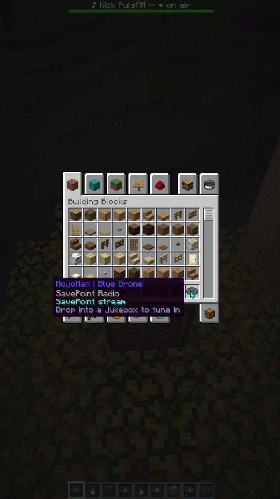

# Jockey Radio

**Put a live radio station on a Minecraft music disc.** Drop a configured disc into any
jukebox and everyone nearby hears a live stream, positionally, through
[Simple Voice Chat](https://modrinth.com/mod/simple-voice-chat), as if a radio were playing in
the world. No new items or resource pack, and no Jockey Radio client component; listeners use the
Simple Voice Chat client.

- **Minecraft:** 26.2 · **Loader:** Fabric 0.19.3+ · **Java:** 25
- **Mod id:** `jockey_radio` · **Environment:** server (Jockey Radio client unsupported)
- **Publisher:** GBTI · Featured broadcasting integration: **SavePoint**



## What Jockey Radio is

Jockey Radio turns a jukebox into a broadcast endpoint. A radio disc is a real vanilla music
disc whose audio is served, live, from a source an operator configures. Players within the
disc's radius hear it spatialised through Simple Voice Chat, so a station feels like it is
coming from the block. A vanilla listener needs only the Simple Voice Chat client, nothing else.

We built it to bring **community radio into Minecraft.** The first goal was simple: let a server
play a live or scheduled station broadcast with **[SavePoint](https://savepoint.fm)** directly
in-world, so a community's own radio could air on their server. From there it grew into a general
audio bridge. Today a disc can carry a SavePoint station or any HLS stream, an RTMP feed pushed
from OBS or a DJ rig, a direct audio URL or an uploaded file, or a link from a supported streaming
platform. SavePoint remains the most complete way to run a real station, but it is one source
among many and is never required to use the mod.

The disc's identity lives in its `custom_data`; secrets (stream tokens and keys) stay in the
server-side config and never touch the item. While a disc sits in a jukebox its station plays,
and ejecting it stops the feed. Two jukeboxes playing the same disc share one stream.

## Requirements

**Server**
- **Java 25**, **Fabric Loader 0.19.3+**, and **Fabric API** (`0.155.2+26.2` target).
- **[Simple Voice Chat](https://modrinth.com/mod/simple-voice-chat) (server side) is required** -
  it is how the audio reaches players.
- **ffmpeg** (and **yt-dlp** for platform links). On linux/amd64 these are **bundled in the jar**
  and self-extract on first run (about 250 MB into the config dir); on other platforms put
  `ffmpeg` on the `PATH` or set `ffmpegBinary`.

**To listen:** Fabric Loader + Fabric API + the Simple Voice Chat client. The Jockey Radio jar is
**not** required on the client.

**Client:** do not install the Jockey Radio jar client-side. Listeners only need the normal
Simple Voice Chat client and its dependencies; Simple Voice Chat handles music ducking
automatically while radio audio is playing.

## Install

1. Install Fabric Loader for Minecraft 26.2 on your server.
2. Put **Fabric API**, **Simple Voice Chat** (server), and the **Jockey Radio** jar in `mods/`.
3. Start once: it writes `config/jockey_radio.json` (no stations by default) and, on your first
   disc, `config/jockey_radio/discs.json`.
4. As an operator, run **`/jockey`** to open the admin panel and create your first disc.

## Disc sources (and what each gives you)

Every disc is one of four source types. The player-facing experience is identical - a disc in a
jukebox - but the audio behind it differs:

### Live radio / HLS (SavePoint stations and any HLS)
Streams an HLS playlist and decodes it live. This is the **SavePoint station** path
(`https://<host>/radio/broadcast/<id>/trunk.m3u8`, with an optional access token that is redacted
from every log), and it also plays any other m3u8 / icecast / http stream. A live station drives
the **now-playing boss bar** (station name plus the current track when the source reports it) and
shows **on air / off air** so listeners can tell a live channel from a silent one.

### RTMP receive (push a broadcast in)
The mod runs an ffmpeg RTMP listener; a broadcaster (OBS, a relay, a DJ rig) publishes into it.
One publisher, one port per disc, and a **stream key** gates who may push (never logged, never in
item NBT). Do **not** use port 1935 on a SavePoint host - the mod rejects it and 1936 is the
known-free port.

### File / direct URL (looping)
A direct audio URL or a file dropped in `config/jockey_radio/audio/`, served locally and looped -
ambient beds, event music, a fixed track. A file plays continuously rather than showing live/idle.

### Platform links (SoundCloud, Twitch, Kick, Mixcloud, and more)
yt-dlp resolves a supported page link to a playable stream (a bundled `deno` provides the JS
runtime some sites need). The resolver is **generic**: it hands the link to yt-dlp, so many sites
resolve - SoundCloud, Twitch, Kick, Mixcloud, and **YouTube on a best-effort basis** - though
support and reliability vary by site and some block datacenter IPs.

> ### ⚠️ Read before enabling platform links
> Platform links are **off by default** (`enablePlatformLinks`). Pulling a third-party stream into
> your server and playing it to others may be governed by **that platform's Terms of Service and by
> copyright law.** Before enabling this feature, **review the Terms of Service of each platform you
> intend to use** (YouTube, Twitch, Kick, SoundCloud, Mixcloud, and any other) and confirm you hold
> the right to rebroadcast the content on your server. Enabling `enablePlatformLinks` is your
> explicit acceptance of that responsibility. Jockey Radio distributes no audio itself, grants no
> such rights, and is not affiliated with or endorsed by any of these platforms.

## Admin commands

Run **`/jockey`** (op level 3 by default; the gate is re-checked on every dialog submit) to open a
vanilla dialog UI - create, browse, edit, **test**, give, and delete discs, no client mod needed.
Everything is also available as a subcommand:

| Command | Purpose |
| --- | --- |
| `/jockey give <discId> [player]` | Give an admin registry disc |
| `/jockey station [key] [player]` | Give a disc for a config station |
| `/jockey list` / `/jockey reload` | List discs / reload `discs.json` |
| `/jockey sessions` / `/jockey diag` | Tracked sessions + live feed diagnostics |
| `/jockey heal` | Re-stamp placed discs from the registry (fixes discs made on an earlier build) |

## Configuration

`config/jockey_radio.json` (server) holds the knobs; values are validated and clamped on load. The
ones you are most likely to touch:

```jsonc
{
  "enablePlatformLinks": false,   // gate SoundCloud/Twitch/Kick/YouTube/... (see the warning above)
  "useBundledBinaries": true,     // self-extract the bundled ffmpeg/yt-dlp/deno (linux/amd64)
  "adminPermissionLevel": 3,      // op level required by /jockey (0..4)
  "nowPlayingHud": true,          // the NOW-PLAYING boss bar
  "nowPlayingHudMode": "beacon",  // "beacon" (needs a trigger block nearby) or "always"
  "useRawBroadcastPath": true     // SavePoint raw path vs Direct Stream Access
}
```

Admin discs live in `config/jockey_radio/discs.json` (managed by the `/jockey` UI, hand-editable);
uploaded FILE-disc audio sits alongside in `config/jockey_radio/audio/`.

## Credits & license

- Audio delivery uses the **[Simple Voice Chat](https://modrinth.com/mod/simple-voice-chat)** plugin
  API by Max Henkel (a declared dependency, invoked via its API; none of its code is bundled).
- Bundled binaries: **ffmpeg** (LGPL build), **yt-dlp** (Unlicense), **deno** (MIT); the pure-Java
  **Concentus** Opus encoder is included jar-in-jar. Full notices and license texts ship in
  `THIRD-PARTY-NOTICES.txt` inside the jar.
- **Jockey Radio** is a **GBTI** project, with **SavePoint** as an optional featured broadcasting
  integration. It is not affiliated with or endorsed by Mojang, Microsoft, SoundCloud, Twitch,
  Kick, YouTube, or Modrinth.
- **License:** All Rights Reserved (see [`LICENSE`](LICENSE)); `fabric.mod.json` `license` is `ARR`.
