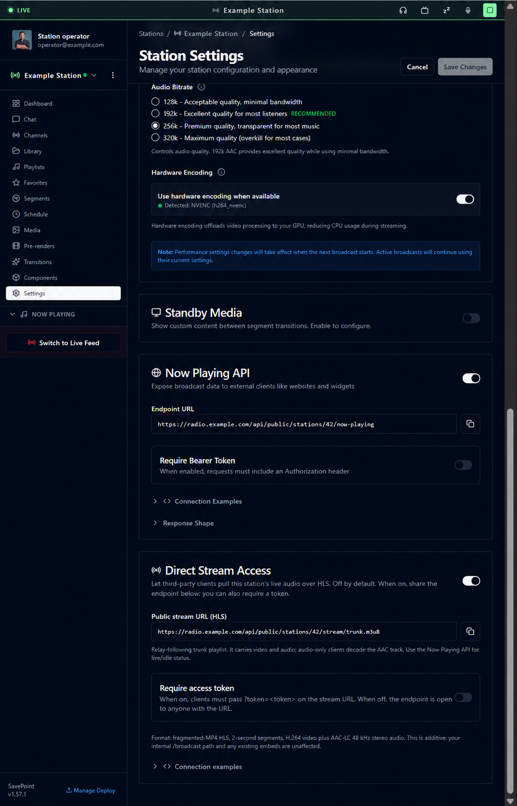
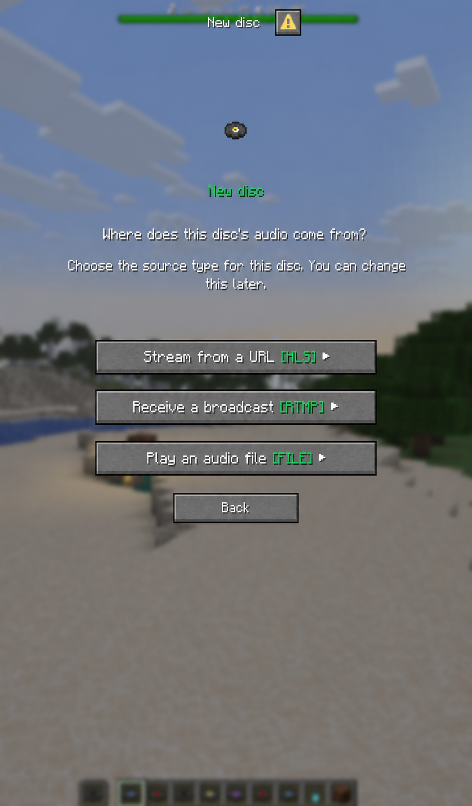
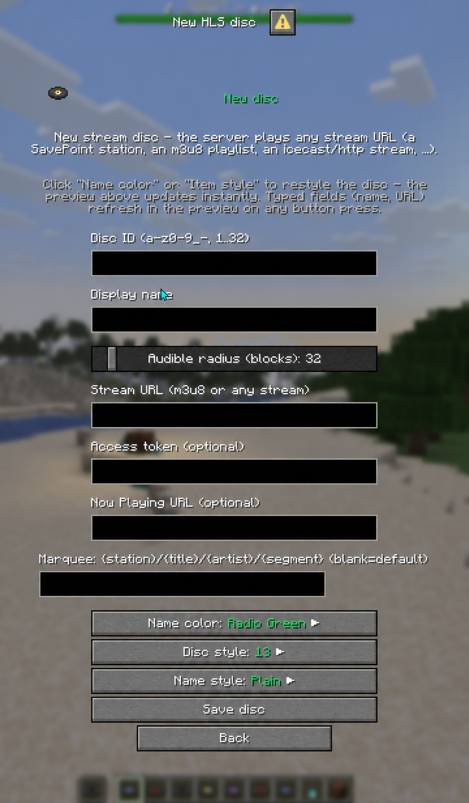
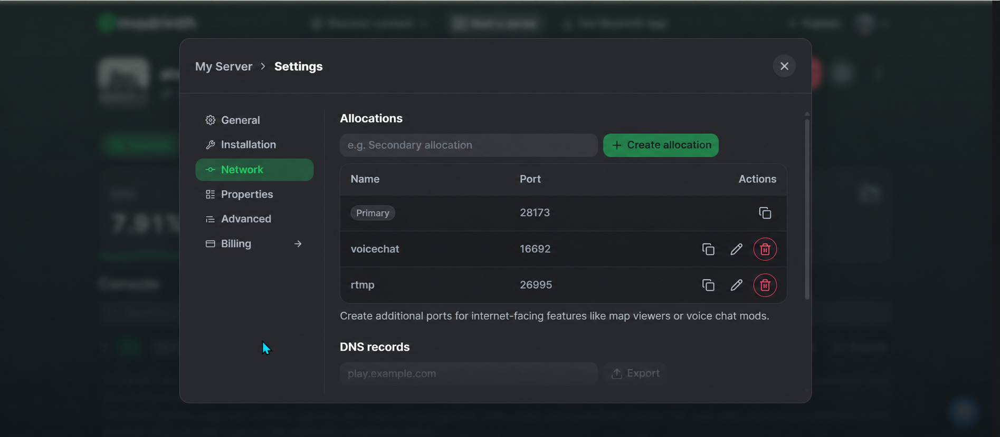
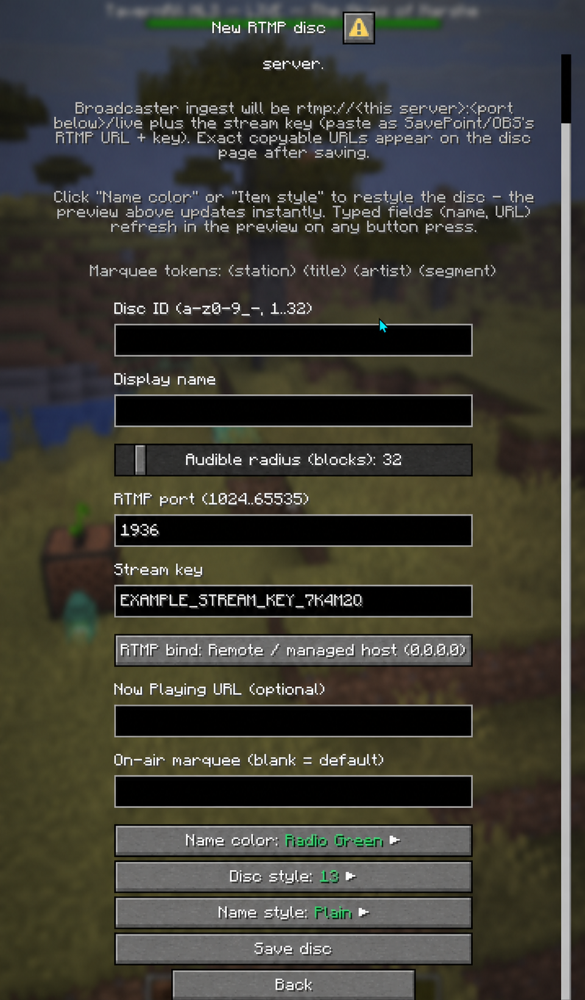
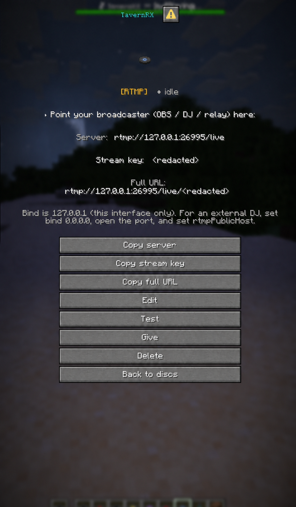
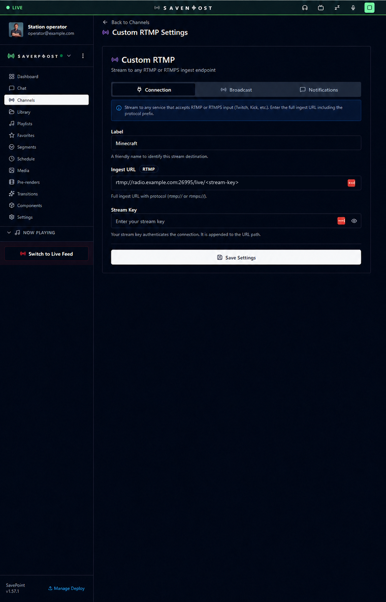
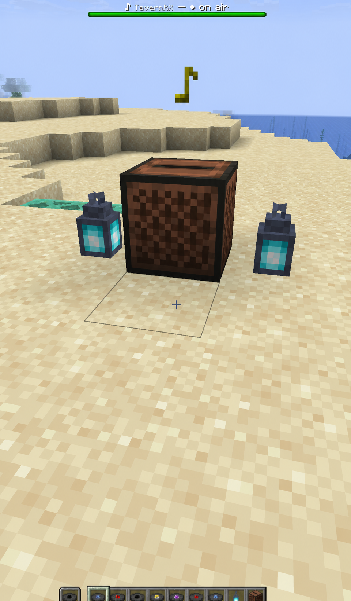

# Connect SavePoint to Jockey Radio

Jockey Radio can carry a SavePoint station into Minecraft in two ways:

- **HLS pull:** Minecraft reads the station stream from SavePoint. This is the simplest setup.
- **RTMP push:** SavePoint publishes directly to an RTMP listener on the Minecraft server. Use this
  when you want a dedicated live ingest connection or HLS is not suitable.

Both paths deliver audio to players through Simple Voice Chat (SVC).

## Before you begin

The Minecraft server needs:

- Jockey Radio, Fabric API, and Simple Voice Chat installed.
- A working Simple Voice Chat connection for every listener.
- Operator access to `/jockey`.

Keep access tokens and RTMP stream keys private. They belong only in server configuration and
SavePoint settings, never in a public screenshot, chat message, item, or documentation.

## Option 1: HLS pull (recommended starting point)

### 1. Enable SavePoint stream access

In SavePoint, enable **Direct Stream Access** for the station. Copy the station's trunk URL:

```text
https://<savepoint-host>/api/public/stations/<station-id>/stream/trunk.m3u8
```

In **Station Settings**, enable both **Now Playing API** and **Direct Stream Access**. The screenshot
uses the fictional identity `Example Station` and safe `radio.example.com` endpoints:



If Direct Stream Access has not been enabled or deployed for your station, use the raw trunk:

```text
https://<savepoint-host>/radio/broadcast/<station-id>/trunk.m3u8
```

Always use `trunk.m3u8`. It follows scheduled playback and live relay takeovers.

### 2. Create the disc

In Minecraft:

1. Run `/jockey`.
2. Select **+ New disc**.
3. Select **Stream from a URL**.

   

4. Enter a disc ID and display name.
5. Paste the `trunk.m3u8` URL into the stream URL field.
6. Optionally enter the SavePoint now-playing endpoint:

   ```text
   https://<savepoint-host>/api/public/stations/<station-id>/now-playing
   ```

7. Save the disc, give it to a player, and place it in a jukebox.

The HLS form keeps the stream, optional access token, and now-playing endpoint server-side:



If the stream or now-playing endpoint requires a token, configure it server-side. Do not place a
token directly in a URL that will be shared or photographed.

## Option 2: RTMP push

RTMP requires a distinct externally reachable **TCP port** for each RTMP disc.

### 1. Allocate a port on managed hosting

In your host's network settings, create an additional allocation for RTMP and note its port. For
example:

```text
Public host: radio.example.com
Allocated port: 26995
```

The allocation alone does not make a loopback listener reachable. The disc must listen on all
interfaces.

On Modrinth Hosting, create and name the allocation under **Settings → Network**:



### 2. Create or edit the RTMP disc

In `/jockey`, create an **RTMP receive** disc or edit an existing one:

- **RTMP port:** the allocated port, such as `26995`.
- **RTMP bind:** **Remote / managed host (`0.0.0.0`)**. New discs select this by default.
- **Stream key:** generate a new private key.
- **Now Playing URL:** optional; use the station's SavePoint now-playing endpoint.

Save the disc. Do not select **Local broadcaster only (`127.0.0.1`)** for a remote SavePoint
publisher. That bind is only for a broadcaster running inside the same machine or container.
Existing discs retain their saved bind when edited, so check older discs explicitly.

The new-disc form selects the managed-host bind and keeps the on-air marquee field aligned with the
other inputs:



The detail screen explicitly warns when a disc is still local-only:



For cleaner copyable connection details, set this in `config/jockey_radio.json`:

```json
{
  "rtmpPublicHost": "radio.example.com"
}
```

`rtmpPublicHost` is a bare hostname. Do not include `rtmp://` or `/live`. Jockey Radio appends each
disc's allocated port. A `host:port` value is supported for a single fixed-port deployment, but it
would override the displayed port for every RTMP disc. This setting controls the external address
shown by Jockey Radio; the disc's `0.0.0.0` bind is what actually accepts remote traffic.

Restart the server after changing the JSON configuration. Editing and saving the disc reconciles its
always-on RTMP listener.

### 3. Configure SavePoint Custom RTMP

In SavePoint, add a Custom RTMP destination:

```text
Ingest URL: rtmp://<public-host>:<allocated-port>/live
Stream Key: <the disc's stream key>
```

For the example above:

```text
Ingest URL: rtmp://radio.example.com:26995/live
```

Save the destination and restart or toggle the Custom RTMP output so SavePoint opens a fresh
connection. If SavePoint expects one combined field, use:

```text
rtmp://<public-host>:<allocated-port>/live/<stream-key>
```

SavePoint's Custom RTMP screen accepts that combined form:



### 4. Verify RTMP

The disc detail page should show the correct port and an external-ready bind. While SavePoint is not
publishing, the source will show **idle**. When publishing succeeds:

- the HUD changes to **on air**;
- `/jockey diag` shows incoming/delivered frames;
- the jukebox becomes audible after its initial buffer fills.

Successful playback shows the station as **on air** above the active jukebox:



If the public port refuses a TCP connection, check:

1. The server is online.
2. The allocation and disc use the same port.
3. The disc bind is `0.0.0.0`, not `127.0.0.1`.
4. No other disc or process owns the allocated port.
5. The server log contains no `Address already in use`, `Cannot assign requested address`, or
   `Error opening input` warning.

## Simple Voice Chat playback

An **on air** HUD proves the server is receiving the source; it does not guarantee that a particular
client's SVC audio engine is currently playing its spatial channel.

If the HUD says on air but you hear nothing:

1. Confirm normal SVC voice chat works.
2. Check that the Jockey Radio/SVC volume category is not muted.
3. Open SVC audio settings and toggle **3D Audio** away and back.
4. Eject and reinsert the disc.
5. Reconnect the client.

During live Modrinth testing, toggling 3D Audio immediately restored an already-running feed. That
points to SVC client spatial-audio initialization rather than an RTMP failure.

For continuous music, set SVC's client `output_buffer_size` to `16` where available. This raises its
playout buffer from the voice-oriented default of about 100 ms to its stock maximum of about 320 ms.
The server cannot push this client setting.

## Browser HLS versus in-game quality

Browser HLS is the reference-quality path:

- SavePoint supplies AAC-LC at 48 kHz stereo, typically around 192 kbit/s.
- The browser retains stereo and uses a comparatively deep media buffer.

Jockey Radio through SVC is a different delivery path:

- ffmpeg decodes the source to 48 kHz mono PCM;
- Jockey Radio encodes music-mode Opus at high bitrate;
- SVC transports and spatializes the mono audio at the jukebox.

The in-game result tested as clear and high quality, but it is not bit-for-bit or channel-for-channel
identical to browser playback. Mono is appropriate for one positional world source, but it removes
the station's original stereo image.

Server-side testing established:

- the mod can deliver a steady 50 audio frames per second with zero drops and underruns;
- high-bitrate music-mode Opus is materially better than SVC's voice-tuned encoder default;
- moving the development server off a periodically freezing WSL2 VM removed the dominant recurring
  hitch;
- a freeze-free native server produced smooth HLS playback in the tested setup.

The remaining limitation is SVC's client path. Stock SVC is designed for speech and has a small
client-local playout buffer. Browser playback can hide network jitter, client stalls, and short
delivery gaps that stock SVC may expose. Real-WAN parity with direct browser HLS has therefore **not
been proven**.

Practical expectations:

- Prefer HLS pull for the simplest and most resilient station connection.
- Use RTMP when you need a direct push and can allocate a TCP port.
- Ask listeners to use `output_buffer_size=16` if they hear intermittent gaps.
- Consider Opus FEC only for measured packet loss; it trades a small amount of music fidelity for
  isolated-loss recovery and does not fix late packets or client stalls.
